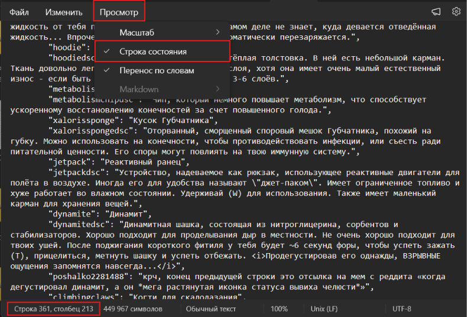
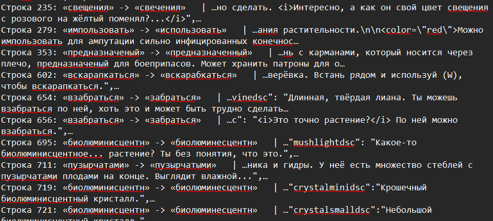

# Q&A
тута будет вио (вопросы и ответы)

## В: Что это за русификатор и для чего он?
О: Я создал этот русификатор для тех, кому надоели однотипные русификаторы для игры Casualties: Unknown. Большая часть из них сделана либо нейронкой, либо через гугл переводчик. Мой - нет, и это делает его более живым. Ну и, разумеется, для обычных игроков, а также для новичков
## В: Кто является автором русификатора?
О: Создатель - CheBuRek8176, помощник - StragAz, тестер - Roketuss, помощники в поиске опечаток - bibas_x2 и MatthewIsMee. Оригинал русификатора - не мой, авторы оригинала (от которого толком ничё не осталось - DeimosW, Noctis, kimki, Feks и Takashi_Wolf)
## В: Какие версии игры поддерживает русификатор?
О:
| Версия игры | Версии русификатора |
| :--- | :--- |
| 1.0 | 0.5-pre5 и выше |
| 7.0.1 | 7.0.1.0 - 0.4.0-pre15 |
| 6.1 (устар.) | 6.1.1 |
| 6.0 (устар.) | [6.0.1-dev1](https://github.com/CheBuRek8176/CU-expand-russification/blob/6373fab452ebcf21176f43e0e6b175fa2fa795e6/RUv6-0-1-dev-1.json) (она не публиковалась в releases) |
| 5-pre5 - 5.1 (устар.) | Версии русика есть, но они приватны (возможно, я их когда-нибудь выложу) |
| 5-pre4 (устар.) | единственная версия русика была утеряна, не поддерж. |
| 1, 2, 3, 4.1 и 5-pre2 - 5-pre3 (устар.) | не поддерживаются |
## В: Могу ли я использовать твой русификатор в своих целях (например, сделать на его основе свой)?
О: **Да**, но с одной оговоркой. Ты должен ***прямо*** упомянуть меня в качестве автора оригинала и (желательно) предупредить меня в Telegram/Discord
## В: У меня не работает русификатор!
О: Если у тебя не работает русификатор, проверь:
1. Правильно ли ты установил русификатор?
2. Видит ли русификатор игра?
3. Отображается ли красная надпись **Invalid!**

Если ты застрял на 3-м пункте, сверь:
1. Ты скачивал версию из вкладки Releases или из исходного кода (blob/main) (настоятельно рекомендуется из Releases)?
2. Ты скачивал последнюю версию?
3. Ты пробовал скачать старые версии русификатора?

Если ты скачал последнюю версию, но игра ругается на ошибку - **свяжись с автором** через Telegram/Discord и сообщи: номер версии игры и русификатора, какая ошибка, скрин этой ошибки. Это позволит мне быстрее найти её и исправить

## В: Я нашёл ошибку/опечатку/кривой перевод!
О: Я не машина и не нейросеть, и порой могу опечататься или ошибиться. Если ты нашёл ошибку или опечатку:
1. Запомни, где именно ты нашёл опечатку. Обязательно проверь, что это не было вызвано, например, повреждением мозга (особенно с модом Casualty Psychology). Лучше - заскриншотить
2. Открой файл русификатора через любой удобный тебе редактор, где можно посмотреть номер строки. Если у тебя их нет, нажми ПКМ по файлу, затем открыть с помощью... затем блокнот. Далее включи отображение номера строк:

3. Найди проблемную строку через поиск (CTRL+F). Достаточна парочка ключевых слов, типа:
`"plushie": "Плюшевая игрушка",` - в поиске: плюшевая
Либо, если разбираешься в устройстве файла, найди самостоятельно
Если это отсутствующая строка, (прямо в игре отображается название предмета на английском с маленькой буквы (например `vasopressin`), название + dsc (`vasopressindsc`), или что-то очевидно техническое (`tradergiveitemrefuse`,`braindamagedresponse`,`tutbasic16` и т.д.)) пропусти этот шаг. Если это непереведённый текст (в игре название предмета с большой буквы (`Vasopressin`), осмысленный текст на английском (`(As you tap the PDA screen a few times, it starts to boot up in emergency mode.)`)) - не пропускай - это я не успел перевести))
4. Нажми на строку, чтобы обновить текущую строку (должно выйти типа `Строка 123, столбец 45`)
5. Запомни номер ***СТРОКИ***. "Столбец" (выбранный символ в строке) не нужен
6. Создай Issue на гитхабе при наличии аккаунта или [свяжись со мной](https://github.com/CheBuRek8176/CU-expand-russification#%D1%81%D0%B2%D1%8F%D0%B7%D1%8C-%D1%81-%D0%B0%D0%B2%D1%82%D0%BE%D1%80%D0%BE%D0%BC)
7. В отчёте укажи:
- Версию игры и русификатора
- Список модов (если они имеются)
- Описание ошибки или опечатки или скриншот
- Как это стоит исправить (опционально)

Примеры хороших репортов:
- В строке 123 опечатка "Дниамитная шашка..." - "дниаминтая" (должно быть "динамитная)
- В строке 456 ошибка "...вывела твой чип из строя твой чип..." - повтор слов

Пример хорошего множественного репорта

Я постараюсь ответить в ближайшее время!

